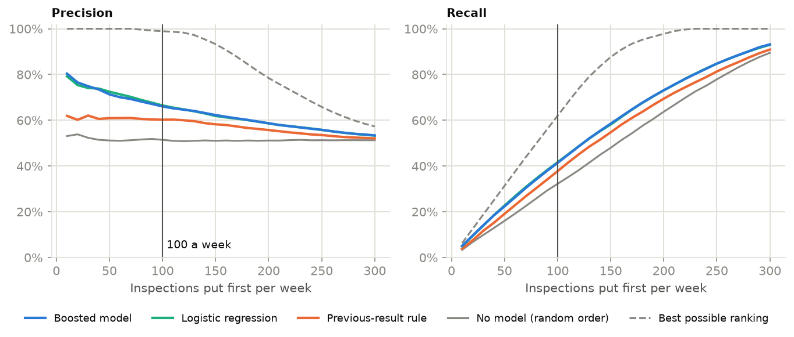
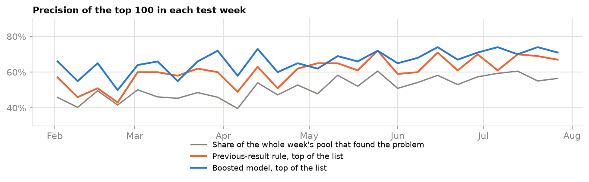
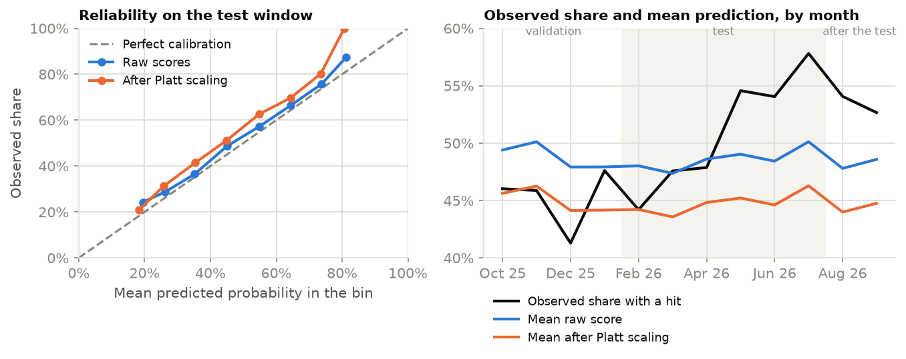
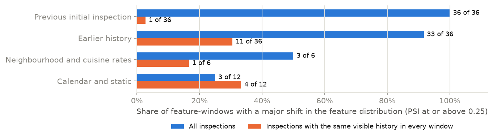

# Which restaurant inspections should go first?

A memo for a program manager, not for a data scientist. It says what I tested, what came out, how far the
result can be trusted and what I would do next. The code, every results file and an interactive
[dashboard](https://muhammad-musa-ml.github.io/restaurant-inspection-risk/) are in the same repository. The
numbers below are copied from the results files by a script; none of them is typed.

## The short version

Say the department can put 100 routine inspections ahead of the rest each week. In the
26 weeks I held back for testing, a week held 312 routine inspections on average, so
100 is about 32% of the pool. I counted an inspection as a hit when it cited
at least two critical violations.

Choosing the 100 at random finds a hit in 51.4% of them, which is about the share of
hits in the pool. Ranking the pool with a boosted-trees model finds a hit in 66.0%. That is
66.0 hits a week where random order gives 51.4, so about 14.6 more, and the
model was ahead of that week's random baseline in 26 of the 26 test weeks.

Two things matter more than that headline. First, a much simpler rule does most of the work: put first the
restaurants whose previous routine inspection went badly. It finds a hit in 60.2%. A plain
logistic regression gets 66.5%, which is as good as the boosted trees. So the evidence
supports ranking the pool; it does not show that the boosted model earns its extra complexity. Second, the
probabilities the model produces are not reliable as numbers, and recalibrating them made that worse. They
are good enough to put inspections in order. I would not show an inspector one as the chance of a problem.

## The question, and what counts as a hit

The question as first posed was whether an inspection will find a critical violation. The data makes
that question nearly empty. In the training weeks 88.5% of routine inspections already cite at
least one critical violation, so there is almost nothing to rank, and even a perfect ordering could beat
random order by a factor of only 1.13. I moved the bar to at least two critical violations, which about half of
inspections reach (49.2% in the training weeks). I chose that from the training weeks alone. The
original question is still answered: on the first target the model's top 100 contain a hit
94.6% of the time, the previous-result rule gets 89.4%, and the whole pool
is at 88.5%.

Only routine inspections (the data calls them initial cycle inspections) are ranked, because those are the
ones a department can bring forward or push back. A reinspection follows from an earlier result and is not a
choice. The department's real weekly capacity and schedule are not in the public data, so 100 a
week is my assumption. The dashboard has a slider for other values.

One more point on how to read "a hit". Every inspection in the data did take place, so I can see how each
one turned out. The test is whether the ones the model put at the top of a week's list were the ones that
turned out badly. It does not tell us what the department would have found had it followed the list: the
inspections that list would have pushed later still happened that same week.

## How I tested it

The source is the city's own "Restaurant Inspection Results" dataset on NYC Open Data. I downloaded one
copy on 2026-10-24 (the publisher had last updated it at 2026-10-23 22:05 UTC). It has 294,406
rows, one per violation cited. I asked only for the columns I use, so there are no restaurant names,
addresses or phone numbers anywhere in the repository.

For each inspection the model sees only what was known before that day: how the restaurant's earlier
inspections went, how long ago they were, how often inspections in the same cuisine and the same ZIP code
had been hits earlier on, and the month and weekday. A test that cuts the data off at an inspection's date
and checks that its features do not change guards this, and so do deliberately leaky versions of the
feature code that the tests must catch.

I split the data by time, so the model is always scored on weeks later than anything it was trained or tuned
on:

| window | first inspection | last inspection | inspections | weeks | with a hit |
|---|---|---|---|---|---|
| train | 2024-10-21 | 2025-10-04 | 11,655 | 50 | 49.2% |
| validation | 2025-10-06 | 2026-01-31 | 4,668 | 17 | 45.1% |
| test | 2026-02-02 | 2026-08-01 | 8,124 | 26 | 51.1% |
| after the test | 2026-08-03 | 2026-10-03 | 3,199 | 9 | 53.5% |

The model is trained on the first window, and its settings, including the calibration, are chosen on the
second. Nothing is chosen on the third; the results are measured there. The fourth window is only watched, to see what happens to months the model never saw. Anything with
chance in it (the boosting seed, how ties are broken) was run 5 times, and results are given as the median
with the lowest and highest in brackets. 5 seeds do not tell you how much the choice of test weeks
matters, so I also resampled the test weeks 2,000 times to get an interval.

## What I found

### Ranking beats random order, but not by a lot

Putting the first 100 of each test week in model order, median over 5 seeds with the range
in brackets:

| model | precision | recall | lift | found per week |
|---|---|---|---|---|
| No model (random order) | 51.4% (50.1-52.0) | 32.2% (31.4-32.5) | 1.01 (0.98-1.02) | 51.4 (50.1-52.0) |
| Previous-result rule | 60.2% (60.0-60.7) | 37.7% (37.6-38.0) | 1.18 (1.17-1.19) | 60.2 (60.0-60.7) |
| Logistic regression | 66.5% (66.5-66.5) | 41.6% (41.6-41.6) | 1.30 (1.30-1.30) | 66.5 (66.5-66.5) |
| Boosted trees (LightGBM) | 66.0% (66.0-66.4) | 41.4% (41.3-41.6) | 1.29 (1.29-1.30) | 66.0 (66.0-66.4) |

"Lift" is precision divided by the share of hits in the pool (51.1% in the test window). Resampling the
test weeks puts the boosted model's precision between 63.5% and 68.3% (95% interval).
Against the previous-result rule it is ahead by 5.6 points (interval 3.8 to
7.2), and it was ahead in 100% of the resamples. In weekly terms the model beat the
rule in 22 of 26 weeks.

The curves show what happens if the capacity is not 100. The gap to random order is widest when the
list is short and closes as the list grows, which has to happen: a team that visits nearly everything
gains nothing from the order.

The week-to-week spread is large. The boosted model's weekly precision ran from 50% to
74%, which dwarfs its average lead over the rule, so any single week tells you very little.

### A simple rule, or a plain regression, does nearly as well

The logistic regression is level with the boosted model: it was ahead in 12 weeks, behind
in 8 and tied in the other 6, and the difference in precision is -0.4 points (interval
-1.3 to 0.5; the boosted model finished ahead in only 19% of
resamples). The search over boosted-tree settings points the same way. I tried 20 combinations
and the winner was the smallest trees allowed, 2 leaves each, with at least 500 inspections
per leaf. That is the corner of the grid, which I widened twice before looking at any test number, and then
stopped. The simplest trees winning suggests there is not much structure in these features beyond a few
broad effects.

Those broad effects are mostly about the past. Three columns account for 66% of the model's
gain, and the biggest is `cuisine_prior_rate` at 32.2%:

| column | what it is | share of gain, median (min-max) |
|---|---|---|
| `cuisine_prior_rate` | share of the cuisine's earlier initial inspections that were hits (smoothed) | 32.2% (29.3-34.8) |
| `prev_ci_score` | inspection score at the restaurant's previous initial inspection | 20.1% (19.6-21.8) |
| `last_score` | score at the restaurant's latest earlier inspection of any kind | 14.0% (13.8-14.7) |
| `cuisine_group` | the cuisine (the most common ones, the rest as one group) | 8.4% (6.9-11.1) |
| `zip_prior_rate` | share of the ZIP code's earlier initial inspections that were hits (smoothed) | 7.8% (7.6-8.0) |

### The probabilities need care

For ranking, only the order matters. If someone wants to read the scores as chances, they have to be
calibrated, meaning that of the inspections the model scores at even odds about half should be hits. I checked
this on the test window. The raw scores were close (expected calibration error 0.025). I then applied the
Platt correction, fitted on the validation window as I had planned in advance, and calibration got
worse: 0.063, and the Brier score went from 0.2313 to 0.2347.

The reason is visible in the monthly chart. The share of hits was 45.1% in the validation window the correction
was fitted on and 51.1% in the test window. It moved around inside the test window too, from
44.2% in its first month to a high of 57.8% in July 2026. The model's average score
stayed between 47.4% and 50.1% through the test months. The model ranks well enough, and
it has no way to know that the whole level has shifted.

This also matters if the department sets a fixed cut-off instead of a daily top-N. I set the cut-off at
0.495 so that the validation weeks averaged 100 flagged a week. On the test weeks it flagged
115 a week on average, and between 65 and 175 in individual weeks,
with precision 66.1%. A fixed cut-off does not hold a workload steady; taking the top of each week's list does.

### A random shuffle would not have flattered it here

The usual worry is that a model scored on a random split of the data looks better than it will in use. I
scored the same model both ways:

| scheme | AUC | lift at the same share of the pool |
|---|---|---|
| Time split (the test window) | 0.659 (0.658-0.659) | 1.31 (1.31-1.31) |
| Random split by restaurant | 0.659 (0.651-0.668) | 1.30 (1.28-1.33) |
| Random split by inspection | 0.660 (0.651-0.667) | 1.30 (1.28-1.33) |

The three are the same within the seed ranges, so a random split would not have overstated the result on this data. I did not
test why. My guess is that the features are summaries of earlier records only, and there is little for a
model with this weak a signal to memorise, but that is a guess.

### How much of it rests on past inspections

Without the 24 columns that describe a restaurant's earlier inspections, precision falls from
66.0% to 61.8%, close to the rule baseline's 60.2% and well above random order
(51.4%). So most of what the model knows comes from the restaurant's own history, plus the cuisine
and ZIP-code rates.

Two checks on the history itself changed little. The publisher keeps only inspections from the three years before
each restaurant's latest one, so a restaurant that is inspected often loses its older records sooner. To keep that from
leaking information about the future I ignore everything before 2023-10-22 for every restaurant. Skipping that
rule gives 66.7% instead of 66.0%, so the effect was small here, but it is the kind of error that
would be easy to make without noticing. Second, the file holds each old inspection as it ended up after any hearing, not as it looked
the next day. Leaving out the most recent 30, 60 or 90 days of history gives 66.2%, 66.2% and 66.1%, which is no real change.

### The data is moving, and most of the alarms trace back to how it is published

Comparing each month's feature values with the training window, 299 of 360 feature-months show a
major shift (population stability index of 0.25 or more), 4 a moderate one and 57 none.
Random samples of the training window itself, as large as a month, score 0.0023 at the median and 0.028 at the
most, so this is not sampling noise.

It is mostly the window moving. The share of inspections whose previous routine inspection is visible rises from
45% in the training window to 80% in the test window, because later windows see more of the three years of history.
To test that, I repeated the comparison only on inspections whose previous routine inspection was within the last 365 days.
Every window sees that same stretch of past. Only 10% of inspections qualify, so this is done per window, not per month. On those, 17
of 90 feature-windows show a major shift against 75 of 90 for all inspections, and for the columns
about the previous inspection the count drops from 36 of 36 to 1.

| feature group | major shifts, all inspections | major shifts, same visible history |
|---|---|---|
| Previous initial inspection | 36 of 36 | 1 of 36 |
| Earlier history | 33 of 36 | 11 of 36 |
| Neighbourhood and cuisine rates | 3 of 6 | 1 of 6 |
| Calendar and static | 3 of 12 | 4 of 12 |

The columns that add up over the whole visible history still shift (11 of 36), as they would,
because matching does not shorten the past they see. The calendar and static columns (month, weekday, borough, cuisine)
do not follow the pattern (3 of 12 against 4). I did not look into them; each
window covers different months, so the month column at least has to differ. The last window has only 278 matching rows and a noise
floor of up to 0.17, so I would not read much into it. The score distribution itself, the thing the ranking depends on,
stayed stable: its largest monthly index is 0.023, below the moderate cut-off of 0.1.

## What I would not conclude

- That the model would find 14.6 more problems a week in practice. The test measures ranking inside the week's
  pool of inspections that really happened. It does not know which restaurants the department would have scheduled otherwise.
- That the labels are final. The publisher's data keeps only violations that were upheld or still waiting for a hearing, and the
  newest inspections have had the least time to be adjudicated. I have one copy of the data, so I cannot measure how much recent counts will change.
- That older months are complete. Only restaurants that were open on the day I downloaded appear, so restaurants that closed
  are missing from the past. This could push the share of hits in either direction.
- That a restaurant's cuisine, ZIP code or borough were what they are in the data on the day of an old inspection. The file has one current value each.
- Anything about why a restaurant has violations. The features predict; they do not explain.

## What I would do with this

- Start with the rule, not the model. Putting first the restaurants whose last routine inspection went badly captures most of the
   gain (60.2 hits a week at 100, against 66.0 for the model and 51.4 at random). It needs no
   software beyond a sort, and anyone can see why a restaurant is near the top. A logistic regression is the next step up: it is
   about 6 points more precise than the rule at the same capacity.
- Rank within each week and take the top of the list. Do not use a fixed score cut-off, which swings the weekly workload.
- If scores are shown to inspectors as probabilities, recalibrate them on recent weeks and check them monthly against the
   observed share of hits. Watch the share of hits and the average score together, because the model does not follow the level.
- For drift, watch the score distribution and the share of hits first. Feature-by-feature alarms will mostly fire because history
   grows as time passes, and I would only trust them on inspections with the same visible history.
- Before relying on any of this, repeat the test on the department's own schedule and on labels after hearings. That data is not public, and it is the
   evidence this memo cannot provide.

## Reproducing it

The README has the commands. The short version: `python scripts/run_pipeline.py` regenerates every table from the saved snapshot in
`data/`, `python scripts/check_reproducible.py` confirms it matches what is committed, and `python scripts/render_docs.py` rewrites this
memo and the README from the results. The runs behind these numbers finished on 2026-10-24 on Windows 11 (10.0.26200), AMD64 with Python 3.13.5.
